# php-barcode

Barcodes for PHP, from the humble Code 39 on a warehouse shelf to the QR code on a restaurant table. 59 barcode types, eight output formats and no required extensions. Every symbol is checked against a real decoder or the official test vectors.

<p>
  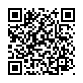&nbsp;
  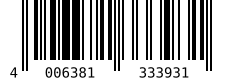&nbsp;
  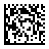&nbsp;
  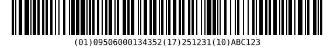&nbsp;
  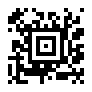
</p>

```php
use PhpBarcode\Barcode;

echo Barcode::qrCode('https://example.com');               // inline SVG
Barcode::ean13('400638133393')->save('product.png');        // check digit added for you
Barcode::gs1128('(01)09506000134352(17)251231(10)ABC123')->save('label.pdf');
```

This started life in 2003 as a 150-line script for a blog post, ["How To Create Barcodes in PHP"](http://davidscotttufts.com/2009/03/31/how-to-create-barcodes-in-php/). Version 2 is a rewrite. The old `barcode.php?text=…` URLs and the `barcode()` function still work. See [Upgrading from 1.x](#upgrading-from-1x).

## Contents

- [Installation](#installation)
- [The basics](#the-basics)
- [Which barcode should I use?](#which-barcode-should-i-use)
- [Every supported barcode](#every-supported-barcode)
- [Output formats](#output-formats)
- [Size, text and colour](#size-text-and-colour)
- [Printing at an exact size](#printing-at-an-exact-size)
- [Styled QR codes](#styled-qr-codes)
- [QR code payloads](#qr-code-payloads)
- [GS1: product, logistics and healthcare labels](#gs1-product-logistics-and-healthcare-labels)
- [Symbology options](#symbology-options)
- [Errors](#errors)
- [Command line](#command-line)
- [HTTP endpoint](#http-endpoint)
- [Upgrading from 1.x](#upgrading-from-1x)
- [Extending](#extending)
- [How it's tested](#how-its-tested)
- [Credits and licence](#credits-and-licence)

## Installation

```bash
composer require davidscotttufts/php-barcode
```

PHP 8.2 or newer. That's the only hard requirement.

- **SVG, PDF, EPS and text** output work on any PHP install.
- **PNG, JPEG, GIF and WebP** need the GD extension (`ext-gd`), which most hosts have.
- `mbstring` and `iconv` are used when present, for Kanji in QR codes and accented captions.

Not using Composer? Download the repository and `require 'php-barcode/src/autoload.php';`.

## The basics

Pick a barcode, give it data, render it. A `Barcode` is immutable, so you can build one and render it several ways.

```php
use PhpBarcode\Barcode;

$barcode = Barcode::code128('SHIP-2026-0042');

$barcode->toSvg();                  // string: an SVG document
$barcode->toPng();                  // string: PNG bytes
$barcode->save('label.pdf');        // format chosen from the extension
$barcode->toDataUri();              // "data:image/svg+xml;base64,…" for 
$barcode->output('png');            // sends headers + image to the browser
echo $barcode;                      // inline <svg> for templates
```

There are shortcuts for the common types. Everything else goes through `Barcode::of()` with a type name, which ignores case, spaces and dashes (`'EAN-13'`, `'ean_13'` and `'ean13'` all work):

```php
Barcode::of('datamatrix', 'Hello');
Barcode::of('itf14', '15400141288763');
Barcode::of(BarcodeType::IntelligentMail, '01234567094987654321-01234567891');
```

Settings come from chainable `with…()` methods. Each one returns a new copy:

```php
Barcode::code128('ABC-123')
    ->withBarHeight(80)       // px
    ->withModuleWidth(3)      // px per narrowest bar
    ->withColors('#1f2937', '#ffffff')
    ->save('abc.png');
```

## Which barcode should I use?

If someone else is going to scan it, they usually decide. If it's up to you:

| You need to… | Use |
|---|---|
| Link a phone to a URL, Wi-Fi network, contact or payment | **QR Code** |
| Sell a product in a shop | **EAN-13** (UPC-A in North America), from a GS1-issued GTIN |
| Label a book, magazine or sheet music | **ISBN**, **ISSN**, **ISMN** |
| Label cartons or pallets for a retailer's warehouse | **GS1-128** or **ITF-14** |
| Mark small parts or medical devices (UDI), or put a lot of data in a small square | **Data Matrix** (GS1 DataMatrix for healthcare) |
| Print boarding passes, tickets or ID cards | **Aztec** or **PDF417** |
| Ship parcels with UPS | **MaxiCode** with the UPS structured message (`new MaxiCode(postalCode: …, countryCode: …, serviceClass: …)`) |
| Put an internal ID on an asset, file or shelf | **Code 128**: compact, full ASCII, read by every scanner |
| Talk to legacy equipment | **Code 39**, **Interleaved 2 of 5** or **Codabar**, whichever it expects |
| Send mail in bulk | Your postal service's code: **Intelligent Mail**, **Mailmark**, **KIX**… |

## Every supported barcode

Each of these was rendered from the line next to it. The images are in [`docs/images`](docs/images), and you can regenerate them with `php examples/gallery.php`.

### Two-dimensional codes

| | Type | Example |
|---|---|---|
|  | QR Code<br>`qr` | `Barcode::of('qr', 'https://github.com/davidscotttufts/php-barcode')` |
| 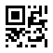 | Micro QR<br>`microqr` | `Barcode::of('microqr', 'HELLO 123')` |
| 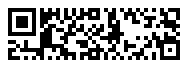 | Rectangular Micro QR (rMQR)<br>`rmqr` | `Barcode::of('rmqr', 'https://example.com/r/42')` |
|  | Data Matrix<br>`datamatrix` | `Barcode::of('datamatrix', 'PhpBarcode Data Matrix')` |
|  | Aztec Code<br>`aztec` | `Barcode::of('aztec', 'Boarding pass M1DOE/JANE')` |
| 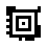 | Aztec Rune<br>`aztecrune` | `Barcode::of('aztecrune', '42')` |
| 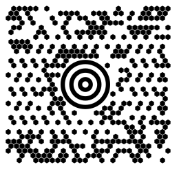 | MaxiCode (UPS)<br>`maxicode` | `Barcode::of('maxicode', 'Ship to: 1 Infinite Loop, Cupertino')` |
| 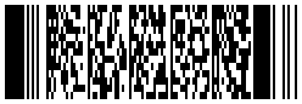 | PDF417<br>`pdf417` | `Barcode::of('pdf417', 'PDF417 stacks rows of codewords to hold a lot of data.')` |
| 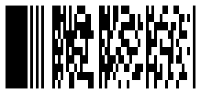 | Compact PDF417<br>`pdf417compact` | `Barcode::of('pdf417compact', 'Compact PDF417')` |
| 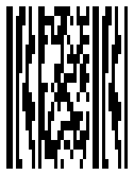 | MicroPDF417<br>`micropdf417` | `Barcode::of('micropdf417', 'MicroPDF417')` |

### Retail

| | Type | Example |
|---|---|---|
|  | EAN-13<br>`ean13` | `Barcode::of('ean13', '4006381333931')` |
| 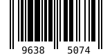 | EAN-8<br>`ean8` | `Barcode::of('ean8', '96385074')` |
| 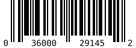 | UPC-A<br>`upca` | `Barcode::of('upca', '036000291452')` |
| 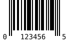 | UPC-E<br>`upce` | `Barcode::of('upce', '01234565')` |
| 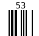 | EAN-2 add-on<br>`ean2` | `Barcode::of('ean2', '53')` |
| 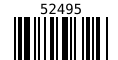 | EAN-5 add-on<br>`ean5` | `Barcode::of('ean5', '52495')` |
| 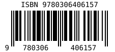 | ISBN<br>`isbn` | `Barcode::of('isbn', '978-0-306-40615-7')` |
| 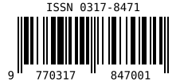 | ISSN<br>`issn` | `Barcode::of('issn', '0317-8471')` |
| 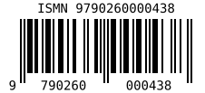 | ISMN<br>`ismn` | `Barcode::of('ismn', '979-0-2600-0043-8')` |

### GS1 logistics

| | Type | Example |
|---|---|---|
|  | GS1-128<br>`gs1128` | `Barcode::of('gs1128', '(01)09506000134352(17)251231(10)ABC123')` |
| 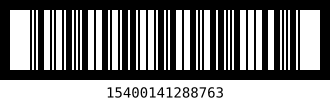 | ITF-14<br>`itf14` | `Barcode::of('itf14', '15400141288763')` |
| 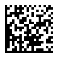 | GS1 DataMatrix<br>`gs1datamatrix` | `Barcode::of('gs1datamatrix', '(01)09506000134352(17)251231(10)ABC123')` |
| 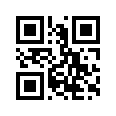 | GS1 QR Code<br>`gs1qr` | `Barcode::of('gs1qr', '(01)09506000134352(10)ABC123')` |
| 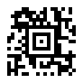 | GS1 Aztec<br>`gs1aztec` | `Barcode::of('gs1aztec', '(01)09506000134352(10)ABC123')` |
| 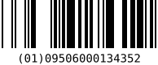 | GS1 DataBar Omnidirectional<br>`databar` | `Barcode::of('databar', '(01)09506000134352')` |
| 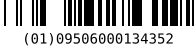 | GS1 DataBar Truncated<br>`databartruncated` | `Barcode::of('databartruncated', '(01)09506000134352')` |
| 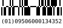 | GS1 DataBar Stacked<br>`databarstacked` | `Barcode::of('databarstacked', '(01)09506000134352')` |
| 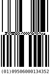 | GS1 DataBar Stacked Omni<br>`databarstackedomni` | `Barcode::of('databarstackedomni', '(01)09506000134352')` |
| 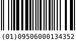 | GS1 DataBar Limited<br>`databarlimited` | `Barcode::of('databarlimited', '(01)09506000134352')` |
| 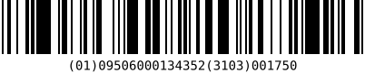 | GS1 DataBar Expanded<br>`databarexpanded` | `Barcode::of('databarexpanded', '(01)09506000134352(3103)001750')` |
| 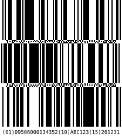 | GS1 DataBar Expanded Stacked<br>`databarexpandedstacked` | `Barcode::of('databarexpandedstacked', '(01)09506000134352(10)ABC123(15)261231')` |

### General purpose and industrial

| | Type | Example |
|---|---|---|
| 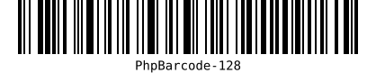 | Code 128 (automatic code sets)<br>`code128` | `Barcode::of('code128', 'PhpBarcode-128')` |
| 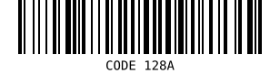 | Code 128, code set A<br>`code128a` | `Barcode::of('code128a', 'CODE 128A')` |
| 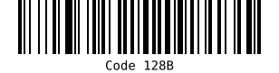 | Code 128, code set B<br>`code128b` | `Barcode::of('code128b', 'Code 128B')` |
| 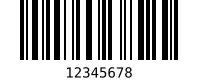 | Code 128, code set C<br>`code128c` | `Barcode::of('code128c', '12345678')` |
| 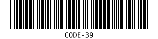 | Code 39<br>`code39` | `Barcode::of('code39', 'CODE-39')` |
| 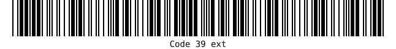 | Code 39 Extended (full ASCII)<br>`code39ext` | `Barcode::of('code39ext', 'Code 39 ext')` |
| 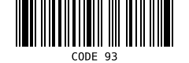 | Code 93<br>`code93` | `Barcode::of('code93', 'CODE 93')` |
| 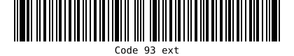 | Code 93 Extended (full ASCII)<br>`code93ext` | `Barcode::of('code93ext', 'Code 93 ext')` |
| 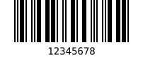 | Interleaved 2 of 5<br>`itf` | `Barcode::of('itf', '12345678')` |
| 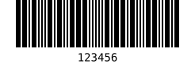 | Industrial (Standard) 2 of 5<br>`industrial2of5` | `Barcode::of('industrial2of5', '123456')` |
| 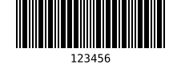 | IATA 2 of 5<br>`iata2of5` | `Barcode::of('iata2of5', '123456')` |
| 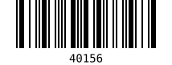 | Codabar<br>`codabar` | `Barcode::of('codabar', 'A40156B')` |
| 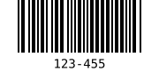 | Code 11<br>`code11` | `Barcode::of('code11', '123-45')` |
| 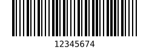 | MSI Plessey<br>`msi` | `Barcode::of('msi', '1234567')` |
| 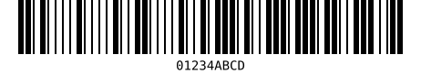 | Plessey (UK)<br>`plessey` | `Barcode::of('plessey', '01234ABCD')` |
| 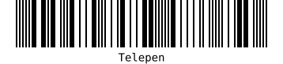 | Telepen<br>`telepen` | `Barcode::of('telepen', 'Telepen')` |
| 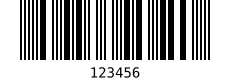 | Telepen Numeric<br>`telepennumeric` | `Barcode::of('telepennumeric', '123456')` |

### Pharmaceutical

| | Type | Example |
|---|---|---|
| 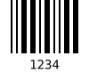 | Pharmacode<br>`pharmacode` | `Barcode::of('pharmacode', '1234')` |
| 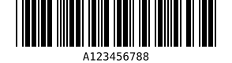 | Code 32 (Italian pharmacode)<br>`code32` | `Barcode::of('code32', '12345678')` |
|  | PZN (German pharmacy)<br>`pzn` | `Barcode::of('pzn', '1234562')` |

### Postal

| | Type | Example |
|---|---|---|
|  | USPS Intelligent Mail<br>`imb` | `Barcode::of('imb', '01234567094987654321-01234567891')` |
|  | USPS POSTNET<br>`postnet` | `Barcode::of('postnet', '55555-1237')` |
|  | USPS PLANET<br>`planet` | `Barcode::of('planet', '40123456789')` |
|  | Royal Mail 4-State (RM4SCC)<br>`rm4scc` | `Barcode::of('rm4scc', 'SN34RD1A')` |
|  | Royal Mail Mailmark (4-state)<br>`mailmark` | `Barcode::of('mailmark', '11210012341234567AB19XY1A')` |
|  | PostNL KIX<br>`kix` | `Barcode::of('kix', '2500GG30250')` |
|  | Australia Post<br>`auspost` | `Barcode::of('auspost', '5956439111ABA 9')` |
|  | Japan Post<br>`japanpost` | `Barcode::of('japanpost', '15400233-16-4-205')` |

## Output formats

| Format | Method | Needs | Notes |
|---|---|---|---|
| SVG | `toSvg()`, `save('x.svg')` | nothing | Best default: tiny, sharp at any size, supports every style option |
| PNG | `toPng()`, `save('x.png')` | GD | Lossless; bar edges snap to whole pixels so they stay crisp |
| JPEG, GIF, WebP | `render('jpeg')` etc. | GD | Only if something insists on these. JPEG blurs bars |
| PDF | `save('x.pdf')` | nothing | One vector page sized exactly to the barcode |
| EPS | `save('x.eps')` | nothing | For InDesign, Illustrator and other print layout tools |
| Text | `toText()` | nothing | Unicode blocks for terminals and logs; QR codes stay scannable |

`render()` takes a format name, an `OutputFormat` case, or any renderer object, so you can pass a configured renderer:

```php
use PhpBarcode\Renderer\JpegRenderer;
use PhpBarcode\Renderer\SvgRenderer;

$barcode->render(new JpegRenderer(quality: 95));
$barcode->render(new SvgRenderer(fontFamily: 'Inter, sans-serif', xmlDeclaration: false));
```

## Size, text and colour

Sizes are in pixels unless you're [printing](#printing-at-an-exact-size). A *module* is the narrowest bar (or one square of a 2D code), and everything scales from it.

```php
Barcode::code128('ABC-123')
    ->withModuleWidth(3)          // default 2 for 1D codes, 4 for 2D codes
    ->withBarHeight(100)          // default 60; 2D codes ignore it
    ->withQuietZone(10)           // blank margin in modules; default is the spec minimum
    ->withText(true, fontSize: 16)
    ->withColors('#0f172a', '#f8fafc')
    ->vertical()                  // rotate 90° clockwise
    ->save('tall.svg');
```

- Linear codes print their data underneath by default; 2D codes don't. Use `withoutText()` or `withText()` to change that.
- EAN and UPC codes use the classic retail layout, with digits between the guard bars and add-ons labelled above.
- A background of `'#ffffff00'` (fully transparent) gives a transparent PNG or SVG.
- PNG output uses GD's built-in font. For a nicer one, pass a TrueType file through `RenderOptions::withFontFile('/path/to/font.ttf')`.

For full control, build a `RenderOptions` and pass it in:

```php
use PhpBarcode\Renderer\RenderOptions;
use PhpBarcode\Renderer\Orientation;

$options = new RenderOptions(
    moduleWidth: 2,
    barHeight: 50,
    showText: false,
    orientation: Orientation::Horizontal,
);

Barcode::of('code93', 'PART-77', $options)->save('part.svg');
```

## Printing at an exact size

Barcode specs are written in millimetres. For example, an EAN-13 at 100% has 0.33 mm modules. `RenderOptions::forPrint()` takes millimetres and a DPI:

```php
use PhpBarcode\Renderer\RenderOptions;

$print = RenderOptions::forPrint(moduleMm: 0.33, barHeightMm: 22.85, dpi: 600);

Barcode::of('ean13', '4006381333931', $print)->save('ean13.pdf');  // a 37.29 mm wide page
Barcode::of('ean13', '4006381333931', $print)->save('ean13.svg');  // width="37.29mm"
Barcode::of('ean13', '4006381333931', $print)->save('ean13.png');  // 600 DPI stored in the file
```

For thermal label printers, pick a module width that's a whole number of printer dots. At 203 DPI one dot is 0.125 mm, so 0.25 mm (2 dots) or 0.375 mm (3 dots) prints cleanly.

## Styled QR codes

Rounded or dotted modules, custom eyes, gradients and a logo. They apply to any 2D code. SVG and PNG support all of them. PDF and EPS draw the shapes and logo, but use the gradient's first colour as a solid fill. Every combination in the test suite still scans.

<p>
  &nbsp;
  &nbsp;
  
</p>

```php
use PhpBarcode\Renderer\Style\FinderShape;
use PhpBarcode\Renderer\Style\Gradient;
use PhpBarcode\Renderer\Style\ModuleShape;

Barcode::qrCode('https://example.com', 'H')
    ->withModuleShape(ModuleShape::Dot)          // Square, Rounded, Dot
    ->withFinderShape(FinderShape::Rounded)      // Square, Rounded, Circle
    ->withGradient(Gradient::linear('#1e3a8a', '#db2777', angle: 45))
    ->withLogo('logo.png', size: 0.2)            // 20% of the code's width
    ->save('menu.png');
```

A logo covers modules, and the code has to rebuild them through error correction. Use error correction level `H`, keep the logo at or below about 20%, and test on a real phone. The modules behind the logo are cleared, plus a one-module margin; pass `new Logo(..., punchout: false)` to overlay it instead. SVG logos work in SVG output. PNG, PDF and EPS need a raster logo.

## QR code payloads

Phones act on specially formatted QR content: they join Wi-Fi, add contacts, and open banking apps. These classes build that content correctly, including the escaping rules nobody remembers:

```php
use PhpBarcode\Payload\{WiFi, VCard, MeCard, EpcPayment, CalendarEvent, Email, Sms, Phone, Geo, Url};

Barcode::qrCode(new WiFi('Cafe Guest', 'espresso;please'));
Barcode::qrCode(new VCard('Ada', 'Lovelace', organization: 'Analytical Engines', phones: ['+44 20 7946 0000'], emails: ['ada@example.com']));
Barcode::qrCode(new EpcPayment('Red Cross Belgium', 'BE72 0000 0000 1616', amountEur: 25.00, remittanceText: 'Donation'), 'M');
Barcode::qrCode(new CalendarEvent('Launch party', new DateTimeImmutable('2026-12-04 19:00'), new DateTimeImmutable('2026-12-04 23:00'), location: 'Rooftop'));
Barcode::qrCode(new Geo(48.8584, 2.2945));
Barcode::qrCode(new Email('hello@example.com', subject: 'Hi'));
```

`EpcPayment` validates the IBAN checksum and follows EPC069-12, the "GiroCode" that European banking apps scan. `MeCard` is a smaller alternative to `VCard` when the code needs to stay small.

Text is encoded efficiently: the encoder splits data into numeric, alphanumeric, byte and Kanji segments to get the smallest possible symbol. Non-ASCII text gets a UTF-8 marker (ECI) so scanners don't garble it.

## GS1: product, logistics and healthcare labels

GS1 barcodes carry *Application Identifiers*: `(01)` is a GTIN, `(17)` an expiry date, `(10)` a batch number, and so on. Write them the way they're printed:

```php
Barcode::gs1128('(01)09506000134352(17)251231(10)ABC123');       // shipping labels
Barcode::gs1DataMatrix('(01)09506000134352(17)251231(10)ABC123'); // healthcare, UDI
Barcode::of('databarexpanded', '(01)09506000134352(3103)001750'); // fresh food with weight
Barcode::digitalLink('(01)09506000134352(10)ABC123');             // QR code with a GS1 Digital Link
```

Every value is checked against the full GS1 dictionary of 541 AIs, generated from the official GS1 Syntax Dictionary. That covers lengths, character sets, check digits, real calendar dates, country and currency codes, and which AIs may or must appear together. When something's wrong, the error says exactly what:

```
AI (01): invalid check digit at position 14, expected 2
AI (17): invalid month "13" at position 3
```

You can also use the parser on its own, for example to read a scanned label:

```php
use PhpBarcode\Gs1\ElementString;
use PhpBarcode\Gs1\DigitalLink;

$label = ElementString::parse("]C101095060001343521725123110ABC123");  // as a scanner sends it
$label->get('17');      // "251231"
$label->toHri();        // "(01)09506000134352(17)251231(10)ABC123"

(new DigitalLink())->toUri('(01)09506000134352(10)ABC123(17)251231');
// https://id.gs1.org/01/09506000134352/10/ABC123?17=251231
```

## Symbology options

`Barcode::of('name', …)` uses sensible defaults. To change a symbology's settings, construct its class and hand it to `Barcode::create()`:

```php
use PhpBarcode\Symbology\{QrCode, DataMatrix, Pdf417, AztecCode, Code39, Itf14, Ean13, BearerBars};
use PhpBarcode\Symbology\QrCode\ErrorCorrectionLevel;
use PhpBarcode\Symbology\DataMatrix\DataMatrixShape;

Barcode::create(new QrCode(ErrorCorrectionLevel::Q, minVersion: 5), $data);
Barcode::create(new DataMatrix(DataMatrixShape::Rectangle), 'LOT 42');
Barcode::create(new DataMatrix(size: '16x48'), 'LOT 42');
Barcode::create(new Pdf417(errorCorrectionLevel: 5, columns: 6), $driverLicence);
Barcode::create(new AztecCode(errorCorrection: 33), $ticket);
Barcode::create(new Code39(withChecksum: true), 'PART-9');
Barcode::create(new Itf14(BearerBars::Horizontal), '15400141288763');
Barcode::create(new Ean13(), '9781234567897+51299');  // EAN-13 with a 5-digit price add-on
```

Commonly used options:

| Symbology | Options |
|---|---|
| `QrCode` | error correction `L`/`M`/`Q`/`H`, fixed or minimum version, mask, ECI, GS1 mode, Kanji, structured append |
| `MicroQrCode`, `RectangularMicroQrCode` | error correction, version or size (`'R11x43'`) |
| `DataMatrix` | square / rectangle / any, fixed size, DMRE sizes, GS1 mode, ECI, structured append |
| `Pdf417`, `MicroPdf417` | error correction level 0–8, columns, rows, aspect ratio, row height, compact mode, Macro PDF417 |
| `AztecCode` | error correction %, layers, compact or full range, GS1 mode, ECI |
| `MaxiCode` | mode 2–6, postal code, country, service class, structured append |
| `Code128` | force code set A, B or C; FNC1 |
| `Code39`, `Interleaved2of5`, `Industrial2of5` | optional check digit, 2:1 or 3:1 wide bars |
| `MsiPlessey` | mod 10, mod 11, mod 1010, mod 1110 |
| `Itf14` | bearer bars: box, top/bottom or none |
| `Ean13`, `UpcA`, `UpcE`, `Ean8` | add-on gap; append `+12` or `+12345` to the data for an add-on |
| `AustraliaPost` | customer, reply paid, routing or redirection |
| `DataBarOmni`, `DataBarExpanded` | stacked layouts, segments per row |

## Errors

Every exception the library throws implements `PhpBarcode\Exception\BarcodeException`, so one `catch` covers everything. The messages are written to be shown to a user who typed in a bad value:

```php
use PhpBarcode\Exception\BarcodeException;

try {
    Barcode::ean13($_POST['gtin'])->output();
} catch (BarcodeException $e) {
    echo $e->getMessage();
    // EAN-13 check digit is invalid: expected "1", got "2".
}
```

Other messages you might see:

- `Code 39 cannot encode character "*" at position 1.`
- `The data (8000 bytes) is too long for a QR Code at error correction level M.`

To check input without exceptions, call `supports()` on any symbology:

```php
(new Ean13())->supports($input);   // true or false
```

## Command line

`vendor/bin/barcode` renders any type from the shell. Without `-o` it draws the barcode in the terminal, and a QR code drawn this way scans straight off the screen.

```bash
vendor/bin/barcode qr "https://example.com"
vendor/bin/barcode ean13 400638133393 -o product.svg
vendor/bin/barcode code128 "SHIP-42" -o label.png --height 120 --module 3
vendor/bin/barcode gs1128 "(01)09506000134352(10)ABC123" -o carton.pdf
vendor/bin/barcode --help
```

## HTTP endpoint

`barcode.php` in the repository root serves images over HTTP, using the same URLs as version 1:

```html


```

| Parameter | Meaning | Default |
|---|---|---|
| `text` | Data to encode (max 256 characters) | `0` |
| `codetype` | Any type name from the gallery above | `code128` |
| `size` | Bar height in px | `20` |
| `sizefactor` | Module width in px | `1` |
| `orientation` | `horizontal` or `vertical` | `horizontal` |
| `print` | `true` to print the text | `false` |
| `format` | `png`, `svg`, `jpeg`, `gif`, `webp`, `pdf`, `eps` | `png` |
| `fg`, `bg` | Hex colours | `000`, `fff` |

Bad input gets a `400` with a plain-text explanation. Sizes are capped so a public endpoint can't be asked for a gigantic image.

## Upgrading from 1.x

Most sites need to change nothing.

- **`barcode.php?text=…` URLs** keep working, with the same parameters and defaults.
- **The `barcode()` function** still exists, with the same signature, once Composer's autoloader (or `src/autoload.php`) is loaded. It's marked deprecated in favour of the `Barcode` class.
- **`filepath` is no longer accepted over HTTP.** In 1.x any visitor could make the script write a file anywhere on your server. Call `->save()` from PHP instead.
- **Interleaved 2 of 5 (`code25`) with an odd number of digits** used to drop the last digit silently. It now pads with a leading zero, as the spec requires.
- **Codabar** no longer silently drops characters it can't encode, and no longer doubles up start/stop characters you supply yourself.
- **A backtick in Code 128** now encodes. In 1.x it hit a typo in the lookup table.
- **Code 39 and Interleaved 2 of 5** default to the more scanner-friendly 3:1 wide-bar ratio. Pass `wideRatio: 2` for 1.x-identical widths.

## Extending

Symbologies and renderers are small interfaces, and everything else (sizing, rotation, every output format) comes for free.

**A new barcode type**: extend `AbstractSymbology` and return a symbol. This one encodes binary digits as wide and narrow bars:

```php
use PhpBarcode\Symbology\AbstractSymbology;
use PhpBarcode\Symbol\LinearSymbol;
use PhpBarcode\Symbol\Symbol;

final class BinaryBars extends AbstractSymbology
{
    public function name(): string
    {
        return 'Binary bars';
    }

    protected function validate(string $data): void
    {
        $this->assertAlphabet($data, '01');   // throws a helpful InvalidDataException
    }

    protected function doEncode(string $data): Symbol
    {
        // "0" → narrow bar, "1" → wide bar, each followed by a narrow space; then a final bar.
        $pattern = strtr($data, ['0' => '11', '1' => '31']) . '1';

        return LinearSymbol::fromWidthString($pattern, $data, $this->name());
    }
}

Barcode::create(new BinaryBars(), '1011')->save('binary.pdf');
```

Return a `LinearSymbol` for bars, a `MatrixSymbol` for a grid of modules, a `HeightModulatedSymbol` for 4-state postal-style bars, or a `HexagonSymbol` for MaxiCode-style hexagons. Anything else can implement the `Symbol` interface and describe itself as rectangles, polygons and rings.

**A new output format**: implement `RendererInterface`, which has three methods: `render(Symbol, RenderOptions): string`, `mimeType()` and `extension()`. The built-in renderers turn a symbol into a `Scene` of shapes (`SceneBuilder`) and draw it on a `Canvas`. Implement `Canvas` to get styling, logos, rotation and text layout for free.

## How it's tested

A barcode that doesn't scan is worse than none, so correctness is checked against outside references wherever possible:

- **Real decoding.** The integration suite renders symbols and decodes them with [zxing-cpp](https://github.com/zxing-cpp/zxing-cpp). That covers every 2D code, every type in the gallery that zxing can read, every output format, and every style option.
- **Bit-for-bit comparison.** QR, Micro QR and rMQR module grids are identical to [segno](https://github.com/heuer/segno) and [Zint](https://zint.org.uk/) across all versions and error correction levels. Linear symbologies that no decoder reads (Code 11, MSI, Plessey, Pharmacode, 2 of 5) are compared against Zint.
- **Official test vectors.** These include ISO examples for QR, Data Matrix and PDF417, all 10,000 cases in the USPS Intelligent Mail test file, and the published samples from Royal Mail, PostNL, Australia Post and Japan Post.
- PHPStan at max level, and CI on PHP 8.2 to 8.5.

```bash
composer test          # unit tests
composer analyse       # PHPStan
composer check         # style + analysis + tests
```

To run the decode tests locally, `pip install zxing-cpp pillow` and set `BARCODE_DECODER="python3 tests/Integration/decode.py"`.

## Credits and licence

Created by [David S. Tufts](http://davidscotttufts.com). MIT licensed; see [LICENSE](LICENSE).

The tables and algorithms follow the ISO/IEC, GS1, USPS and postal-operator specifications. Where an open-source implementation helped clarify a detail, it's credited in the relevant class: [Zint](https://zint.org.uk/) (BSD-3-Clause), [zxing-cpp](https://github.com/zxing-cpp/zxing-cpp) (Apache-2.0), [BWIPP](https://github.com/bwipp/postscriptbarcode) (MIT) and [Nayuki's QR Code generator](https://www.nayuki.io/page/qr-code-generator-library) (MIT). The GS1 Application Identifier data comes from the [GS1 Syntax Dictionary](https://github.com/gs1/gs1-syntax-dictionary) (Apache-2.0).
